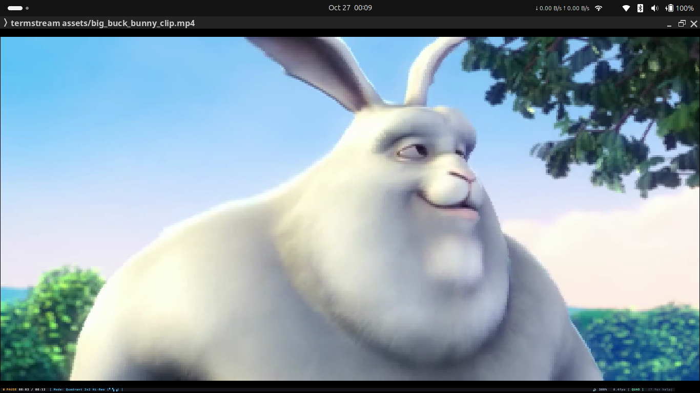
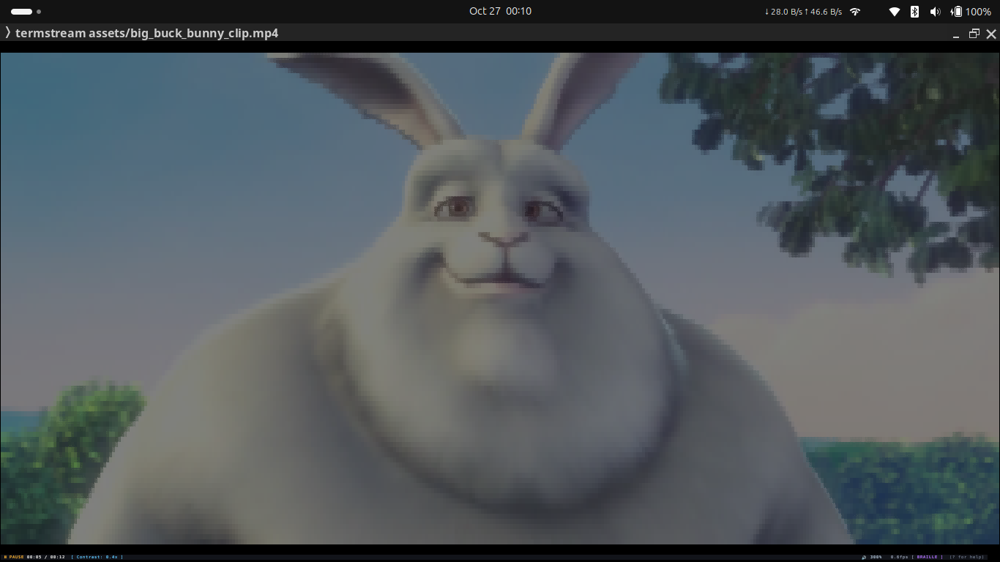
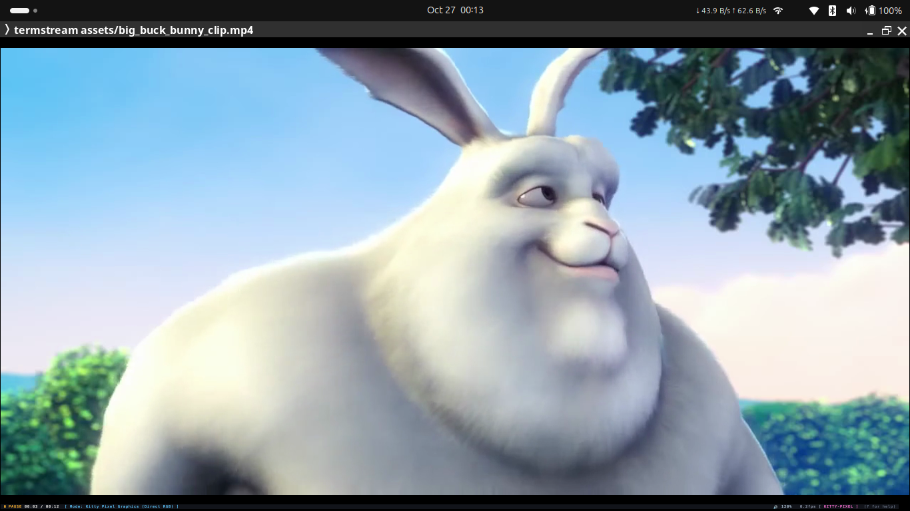
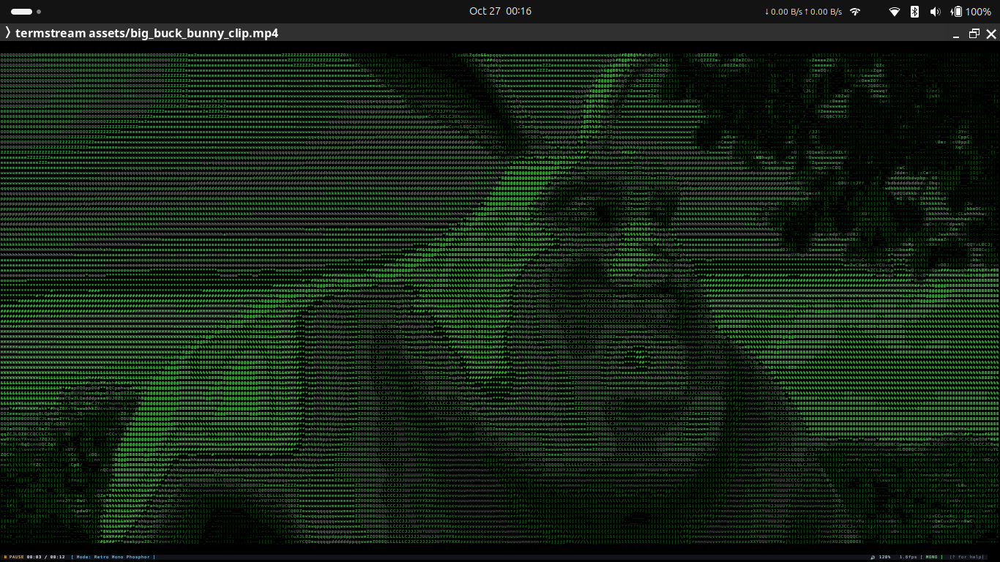
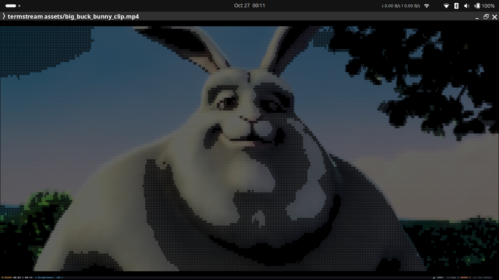
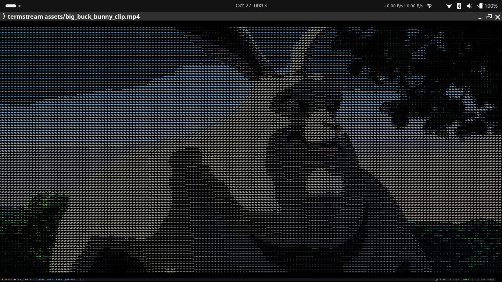
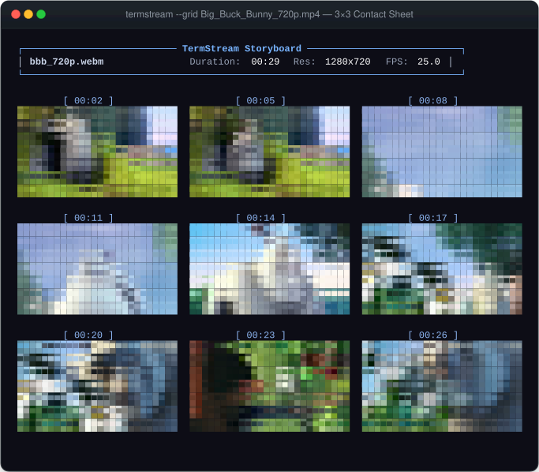

<div align="center">

# 🎬 TermStream

**High-Performance Terminal Video Player in Rust**<br>
*TrueColor 24-bit rendering, monotonic A/V synchronization, direct YouTube streaming, and instant 3×3 video contact sheets.*

[](https://github.com/Sumit4codes/termstream/actions/workflows/ci.yml)
[](https://github.com/Sumit4codes/termstream/releases)
[](LICENSE)
[](https://www.rust-lang.org)
[](https://github.com/Sumit4codes/termstream)

[Quickstart](#-quickstart) • [Features](#-features) • [Interactive Controls](#️-interactive-controls) • [Comparison](#-feature-comparison) • [Architecture](#-architecture)

<br/>



</div>

---

## ✨ Highlights

* **Native TrueColor Graphics**: 24-bit RGB with Unicode Quadrants (`▘▝▖▗`, 4 subpixels/cell), Half-Blocks (`▀`), Adaptive Braille (`⠋⠙⠸`, 8 dots/cell with dynamic edge contrast), Kitty Graphics Protocol, and Sixel.
* **Monotonic A/V Drift Sync**: Lock audio and video to hardware monotonic time. Dynamic frame dropping catches up if terminal I/O latency occurs, with zero cumulative audio drift.
* **Direct Progress Bar Mouse Scrubbing**: Click or drag directly on the interactive bottom progress bar `[━━━●──────]` for instant time-seeking and live timestamp preview.
* **Direct YouTube & Web Video Streaming**: Stream URLs or shorthand IDs (`termstream yt:<id>`) on the fly with zero temporary disk writes via `yt-dlp`.
* **Instant 3×3 Storyboard Contact Sheets**: Generate a 9-keyframe terminal contact sheet (`--grid`) with timestamps and metadata for dataset triage or file managers (`yazi`, `ranger`, `lf`).
* **Zero-Dim Display Power Management**: Automatically prevents desktop idle dimming and screensavers (GNOME, KDE Plasma, systemd, macOS, Windows) during playback, releasing on pause.

---

## 🎨 Visual Showcase & Render Modes

<div align="center">
  <table>
    <tr>
      <td width="50%" align="center"><b>Quadrant 2×2 Hi-Res (4 Subpixels/Cell)</b></td>
      <td width="50%" align="center"><b>Adaptive Braille 2×4 Matrix (8 Dots/Cell)</b></td>
    </tr>
    <tr>
      <td></td>
      <td></td>
    </tr>
    <tr>
      <td width="50%" align="center"><b>Half-Block (TrueColor ▀)</b></td>
      <td width="50%" align="center"><b>Kitty Graphics Protocol (Pixel GPU Texture)</b></td>
    </tr>
    <tr>
      <td></td>
      <td></td>
    </tr>
    <tr>
      <td width="50%" align="center"><b>Retro Phosphor CRT (Matrix Green / Mono)</b></td>
      <td width="50%" align="center"><b>Unicode Block Shades ( ░▒▓█ )</b></td>
    </tr>
    <tr>
      <td></td>
      <td></td>
    </tr>
    <tr>
      <td colspan="2" align="center"><b>Classic ASCII Density Ramp ( @%#*+=-:. )</b></td>
    </tr>
    <tr>
      <td colspan="2" align="center"></td>
    </tr>
  </table>
</div>

### Mode Breakdown
| Mode | Cell Density | Technique | Best For |
| :--- | :---: | :--- | :--- |
| **Kitty Protocol (`-m kitty`)** | **Raw GPU Texture** | Chunked Base64 APC direct pixel transfer | 1080p native resolution on Kitty, Ghostty, WezTerm |
| **Quadrant (`-m quadrant`)** | **2×2 subpixels** | Unicode quadrants with TrueColor FG + BG | Modern high-definition playback, smooth shapes |
| **Braille (`-m braille`)** | **2×4 dots (8 subpixels)** | Adaptive contrast thresholding + TrueColor tint | High-density line art, technical diagrams, anime |
| **Half-Block (`-m half-block`)** | **1×2 pixels** | TrueColor upper half with background color | Clean square-pixel 1:1 aspect ratio |
| **Unicode Shades (`-m shades`)** | **Textured luminance** | Unicode 5-level density blocks (` ░▒▓█`) | High-contrast textured retro display |
| **ASCII Density Ramp (`-m ascii`)** | **Character density** | Retro 70-character luminance ramp | Classic ASCII art terminal aesthetic |
| **Phosphor CRT (`-m mono -f matrix-green`)** | **Monochrome tint** | Phosphor green/amber luminance filter | Demoscene cyberpunk aesthetic |
| **Sixel (`-m sixel`)** | **Indexed 64-Color** | Run-length encoded raster pixel graphics | Foot, iTerm2, WezTerm, mlterm |

---

## 📸 3×3 Video Storyboard & Contact Sheet

Inspect any video or stream instantly without opening a GUI player. Use `--grid` (or `--storyboard`) to print a 9-keyframe contact sheet directly to stdout:

```bash
termstream --grid /path/to/video.mp4
termstream --grid "https://www.youtube.com/watch?v=aqz-KE-bpKQ"
```

<div align="center">
  
</div>

---

## 🚀 Quickstart

### Prerequisites

* **Rust Toolchain**: `cargo` 1.75+
* **FFmpeg**: `ffmpeg` and `ffprobe` installed on your system:
  ```bash
  # Debian / Ubuntu / Mint
  sudo apt install -y ffmpeg libasound2-dev

  # Arch Linux
  sudo pacman -S ffmpeg

  # macOS
  brew install ffmpeg

  # Windows (via Chocolatey / Scoop)
  choco install ffmpeg
  ```
* *(Optional, for YouTube streaming)* **yt-dlp**:
  ```bash
  pip install --user yt-dlp   # or: sudo apt install yt-dlp
  ```

### Build & Run

```bash
# Clone the repository
git clone https://github.com/Sumit4codes/termstream.git
cd termstream

# Build optimized release binary
cargo build --release

# Run built-in procedural demo pattern (zero media files needed)
./target/release/termstream --test
```

Install globally to `~/.cargo/bin`:
```bash
cargo install --path .
```

---

## 🎮 Usage Examples

```bash
# Play local video file
termstream /path/to/movie.mp4

# Stream any YouTube video directly (requires yt-dlp)
termstream "https://www.youtube.com/watch?v=aqz-KE-bpKQ"
termstream yt:aqz-KE-bpKQ

# Play classic "Bad Apple!!" benchmark directly in Braille mode
termstream --bad-apple -m braille

# Play "Never Gonna Give You Up" in high-res Quadrant mode
termstream --rickroll -m quadrant

# Play in retro Matrix Green CRT phosphor mode
termstream -m mono -f matrix-green /path/to/movie.mp4

# Play animation looped without audio
termstream --loop --no-audio /path/to/animation.gif

# Play built-in procedural demoscene demos
termstream test:plasma     # 90s sine wave plasma
termstream test:matrix     # Falling digital rain
termstream test:cube       # 3D rotating wireframe cube
termstream test:bars       # SMPTE color calibration bars

# Inspect media metadata without launching full player
termstream --info /path/to/movie.mp4

# Generate 3x3 keyframe contact sheet / storyboard
termstream --grid /path/to/movie.mp4
```

---

## ⌨️ Interactive Controls

### Mouse & Navigation
| Action | Control | Description |
| :--- | :---: | :--- |
| **Scrub Progress Bar** | <kbd>Mouse Drag / Click</kbd> | Click or drag directly on bottom progress bar for real-time seek |
| **Scroll Wheel Seek** | <kbd>Mouse Scroll Up / Down</kbd> | Seek forward / backward 5 seconds |
| **Jump to Timestamp** | <kbd>g</kbd> or <kbd>:</kbd> | Opens interactive prompt: type `1:23`, `90s`, `45%`, `01:15:30` |

### Playback & Seeking
| Action | Keybinding |
| :--- | :--- |
| **Play / Pause** | <kbd>Space</kbd> or <kbd>k</kbd> |
| **Seek ±5s** | <kbd>→</kbd> / <kbd>←</kbd> or <kbd>l</kbd> / <kbd>j</kbd> |
| **Fast Seek ±15s** | <kbd>]</kbd> / <kbd>[</kbd> |
| **Fast Seek ±30s** | <kbd>Shift</kbd> + <kbd>→</kbd> / <kbd>Shift</kbd> + <kbd>←</kbd> |
| **Leap ±60s (1 min)** | <kbd>PageUp</kbd> / <kbd>PageDown</kbd> |
| **Jump to Start / End** | <kbd>Home</kbd> / <kbd>End</kbd> |
| **Frame Step** | <kbd>.</kbd> (step forward) / <kbd>,</kbd> (step backward) |
| **Percentage Seek** | <kbd>0</kbd> .. <kbd>9</kbd> (0% .. 90% of duration) |

### Picture, Audio & Display
| Action | Keybinding |
| :--- | :--- |
| **Volume Control** | <kbd>↑</kbd> / <kbd>↓</kbd> (±10%, up to 300% boost) |
| **Mute Toggle** | <kbd>m</kbd> |
| **Cycle Render Mode** | <kbd>v</kbd> or <kbd>M</kbd> *(Half-Block → Quadrant → Braille → Shades → ASCII → Mono → Kitty → Sixel)* |
| **Cycle Aspect Ratio** | <kbd>a</kbd> *(Fit / Letterbox → Fill / Crop → Stretch)* |
| **Cycle Color Filter** | <kbd>f</kbd> *(Normal → Matrix Green → Amber CRT → Cyan → Grayscale)* |
| **Brightness** | <kbd>B</kbd> (increase) / <kbd>b</kbd> (decrease) |
| **Contrast** | <kbd>C</kbd> (increase) / <kbd>c</kbd> (decrease) |
| **Invert Colors** | <kbd>i</kbd> |
| **Reset Adjustments** | <kbd>r</kbd> |
| **Looping** | <kbd>p</kbd> or <kbd>L</kbd> |
| **OSD Visibility** | <kbd>Tab</kbd> or <kbd>o</kbd> *(Auto-hide → Always On → Off)* |
| **Help HUD** | <kbd>?</kbd> or <kbd>h</kbd> |
| **Quit** | <kbd>q</kbd> or <kbd>Esc</kbd> |

---

## 📊 Feature Comparison

| Feature | **TermStream** | mpv (`--vo=caca`) | tplay | chafa |
| :--- | :---: | :---: | :---: | :---: |
| **Language** | **Rust (Safe & Fast)** | C | Rust | C |
| **Monotonic A/V Sync** | ✅ Drift-compensated | ❌ Prone to drift | ⚠️ Basic | ❌ No audio |
| **Interactive Progress Bar Scrubbing** | ✅ Mouse click & drag | ❌ | ❌ | ❌ |
| **Jump to Timestamp Prompt** | ✅ `1:23`, `50%`, `90s` | ❌ | ❌ | ❌ |
| **TrueColor Quadrant Mode (2×2)** | ✅ 4 subpixels/cell | ❌ | ❌ | ⚠️ Static only |
| **Adaptive Braille Matrix (2×4)** | ✅ 8 dots with contrast | ❌ | ⚠️ Dither only | ⚠️ Static only |
| **ANSI Escape Compression** | ✅ ~60% bandwidth saved | ❌ | ❌ | ✅ |
| **Zero-Dim Power Management** | ✅ Desktop Inhibit | ❌ | ❌ | ❌ |
| **3×3 Storyboard Generator** | ✅ Built-in (`--grid`) | ❌ | ❌ | ❌ |
| **Zero-Config Procedural Demos** | ✅ Built-in | ❌ | ❌ | ❌ |
| **Software Preamp Boost** | ✅ up to 300% (+2.6 dB) | ❌ | ❌ | ❌ |

---

## 📐 Architecture

TermStream uses a decoupled multi-threaded streaming architecture designed for zero latency and minimal CPU overhead:

```
┌──────────────────┐       Raw RGB24 Pipes
│ FFmpeg / Prober  │ ──────────────────────────┐
└──────────────────┘                           │
                                               ▼
┌──────────────────┐  PCM S16LE  ┌────────────────────────┐
│  Rodio / Audio   │ ◄────────── │ Video & Audio Decoders │
└──────────────────┘             └────────────────────────┘
                                               │
                                               ▼ (Bounded Channel)
┌──────────────────┐    Ticks    ┌────────────────────────┐
│ Monotonic Clock  │ ──────────► │ AV Sync & Frame Dropper│
└──────────────────┘             └────────────────────────┘
                                               │
                                               ▼
                                 ┌────────────────────────┐
                                 │ Color LUT & Geometries │
                                 └────────────────────────┘
                                               │
                                               ▼
                                 ┌────────────────────────┐
                                 │ Mode Specific Renderer │
                                 │ (Block/Braille/ASCII)  │
                                 └────────────────────────┘
                                               │
                                               ▼
                                 ┌────────────────────────┐
                                 │ ANSI Escape Compressor │
                                 └────────────────────────┘
                                               │
                                               ▼
                                 ┌────────────────────────┐
                                 │ Single Flush to Stdout │
                                 └────────────────────────┘
```

1. **Decoder Pipeline**: Spawns an FFmpeg worker that pipes raw `rgb24` frames directly into memory, leveraging hardware SIMD `libswscale` to scale to the terminal's native cell dimensions.
2. **ANSI Code Compression**: In Half-Block and Braille modes, consecutive cells with identical foreground or background colors omit redundant ANSI color escape codes, saving up to 60% of terminal I/O bandwidth.
3. **Double Buffering & Flicker-free Writes**: Terminal output is pre-allocated and written in a single `stdout.write_all()` operation with atomic update escape guards (`\x1b[?2026h`), completely eliminating screen tearing and flickering.
4. **Crash-Resilient Terminal Restoration**: A terminal guard structure implements `Drop`, ensuring that raw mode is disabled, mouse capture is deactivated, and the alternate screen buffer is cleanly restored even on aborts or unexpected signals.

---

## 🧪 Testing & Verification

```bash
# Run all unit and integration tests
cargo test

# Run tests with stdout output
cargo test -- --nocapture
```

---

<div align="center">
  <sub>Built with ❤️ in Rust. Released under the MIT License.</sub>
</div>
